# RaspyTV

Interface Smart TV pour Raspberry Pi 4, construite avec Electron. Elle démarre en kiosque plein écran avec la session graphique (labwc / Wayland) et sert d'accueil au salon. On y trouve la médiathèque Jellyfin, YouTube et YouTube Music sans publicité (NouTube), Twitch, Immich, les jeux du PC via Moonlight et les réglages du système. Tout se pilote à la télécommande, au clavier ou à la manette PS4.

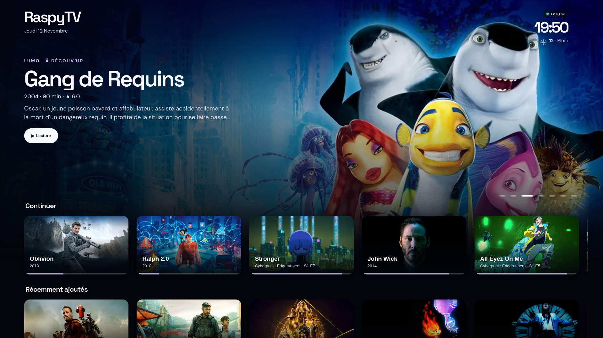

> 🦀 **Version Rust** : une réécriture complète en Rust (tao + wry, accueil en WebAssembly) est disponible dans [RaspyTV-remake-rust](https://github.com/0x80070006/RaspyTV-remake-rust). Cette version Electron reste la version principale.

> 📖 **Documentation complète : [wiki RaspyTV](https://github.com/0x80070006/RaspyTV/wiki)**. Elle couvre l'installation, chaque écran en détail, la manette, la configuration et le dépannage.

## Sommaire

- [Fonctionnalités](#fonctionnalités)
- [Visite guidée](#visite-guidée)
- [Installation](#installation)
- [Configuration](#configuration)
- [Commandes](#commandes)
- [Architecture](#architecture)
- [Licences](#licences)

## Fonctionnalités

- **Accueil cinéma.** Un bandeau présente chaque jour 7 films de la médiathèque Jellyfin tirés au sort, avec défilement automatique et lecture directe. Viennent ensuite les rangées « Continuer », avec la progression de lecture, et « Récemment ajoutés ».
- **Applications persistantes.** Jellyfin, NouTube, NouTube Music, Twitch, un tableau de bord et Immich s'ouvrent chacun dans leur propre vue et gardent leur session. Au-delà d'une limite réglable (2 à 6), les applications les moins récentes sont fermées pour ménager la mémoire du Pi.
- **NouTube intégré.** YouTube et YouTube Music sans publicité, avec les Shorts masqués et SponsorBlock. La musique continue pendant qu'on navigue ailleurs.
- **Jeux Moonlight.** La rangée « Jeux » liste les jeux publiés par le PC (Sunshine / GameStream) et les lance dans `moonlight-qt`.
- **Barre latérale.** Invisible au repos, elle passe au-dessus de toutes les applications. Elle s'ouvre quand le pointeur touche le bord gauche ou depuis la manette (Share).
- **Panneau rapide (PS maintenu).** Il réunit la lecture en cours (jaquette, barre de lecture, précédent / lecture / suivant), le volume, la sortie audio (casques Bluetooth compris), l'état de la manette et l'alimentation du Pi.
- **Paramètres en onglets.** Affichage, Accueil, Son, Applications, Système. Tout se règle à la croix directionnelle.
- **Alimentation sécurisée.** Redémarrer et Éteindre demandent toujours une confirmation, et le focus est placé sur « Annuler ».
- **Mode Tableau.** Diaporama plein écran pour quand la TV ne sert pas.

## Visite guidée

### Accueil, applications et jeux

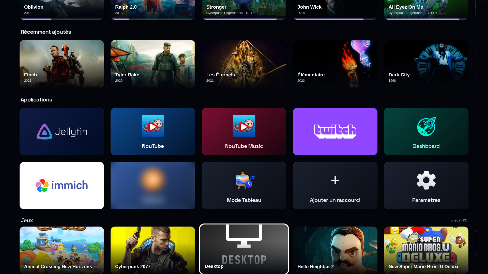

Toutes les tuiles ont le même format 16:9, cinq par ligne. Chaque service affiche son logo sur sa couleur de marque, et « Ajouter un raccourci » crée une tuile vers n'importe quel site. La rangée **Jeux** vient de Moonlight.

### Barre latérale

<p align="center">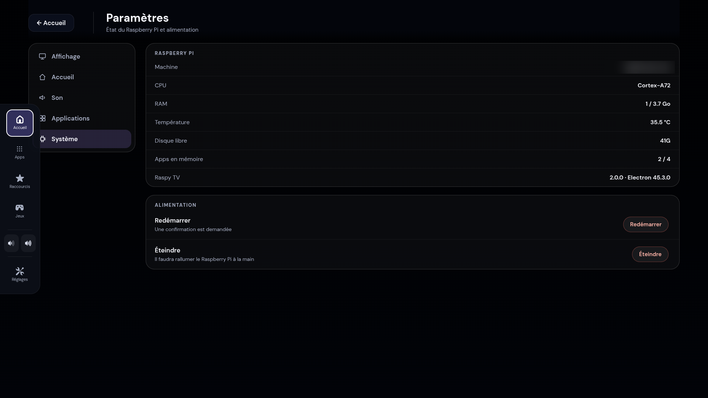</p>

Elle propose Accueil, Apps, Raccourcis, Jeux, le volume (− / +) et Réglages. Elle se replie seule après 4 s sans action à la manette, ou 6 s sans mouvement de souris, même si le pointeur reste posé sur le bord.

### Panneau rapide

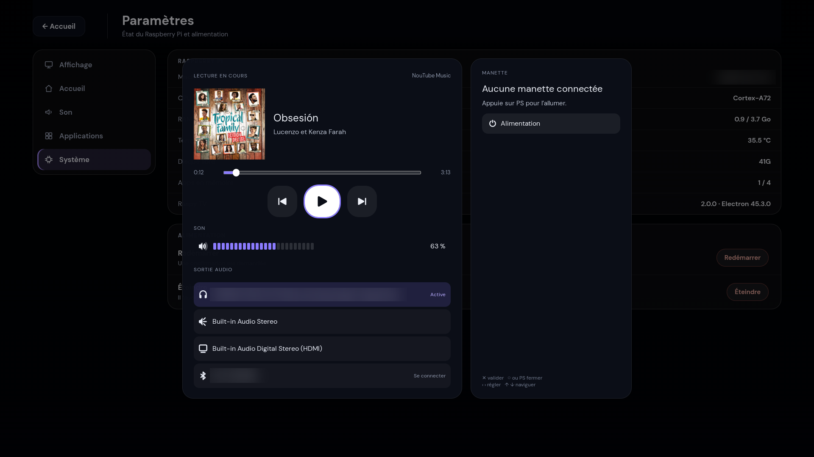

Le panneau s'ouvre en maintenant **PS** une seconde, et un voile assombrit l'écran derrière lui. Il comporte deux cartes :

- **à gauche**, la lecture en cours (NouTube Music en priorité, même depuis l'accueil), le volume et les sorties audio ;
- **à droite**, la manette (batterie, extinction) et l'alimentation du Raspberry Pi.

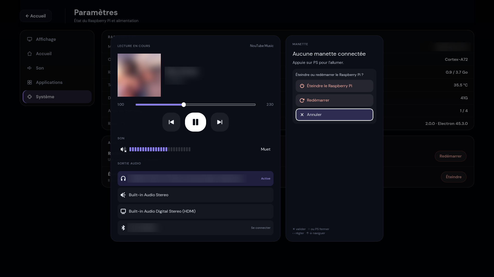

« Alimentation » propose **Éteindre le Raspberry Pi**, **Redémarrer** ou **Annuler**, et le focus part toujours sur Annuler.

### Paramètres

| Affichage | Accueil |
| --- | --- |
| 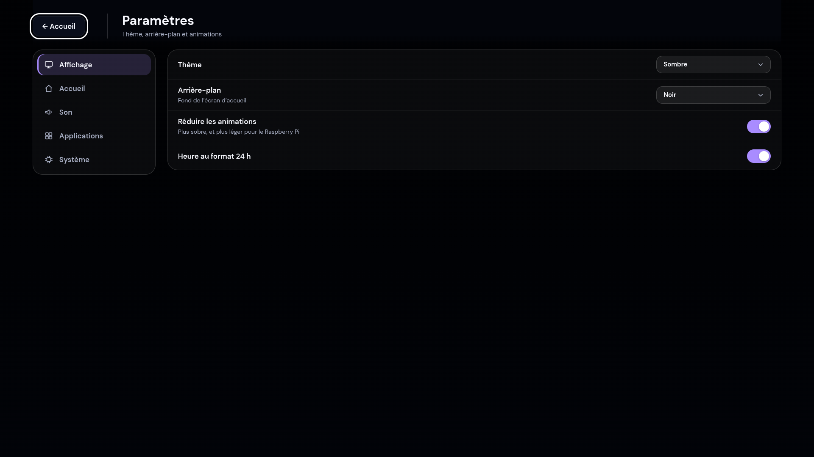 | 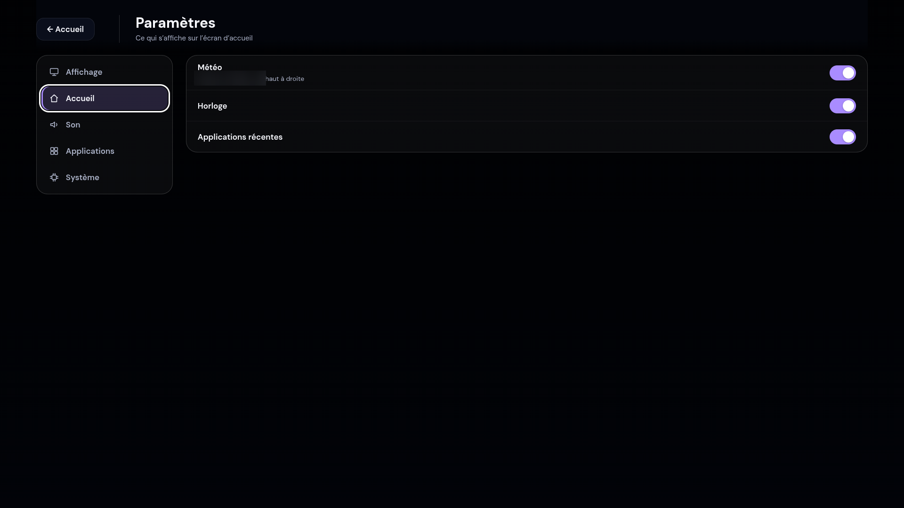 |
| **Son** | **Applications** |
| 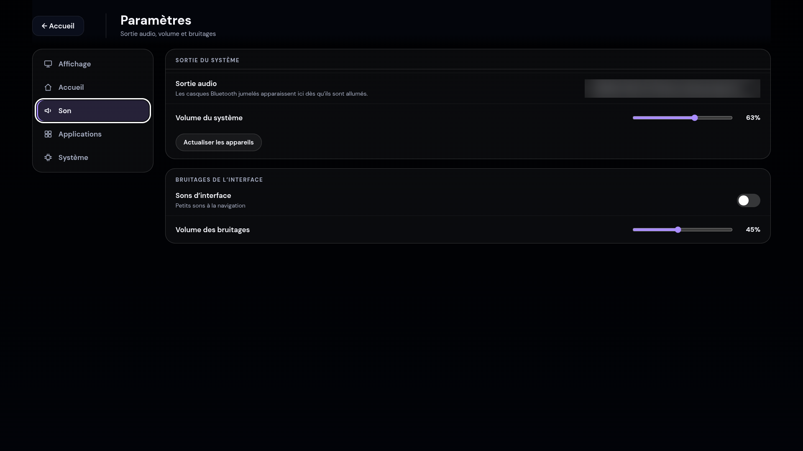 | 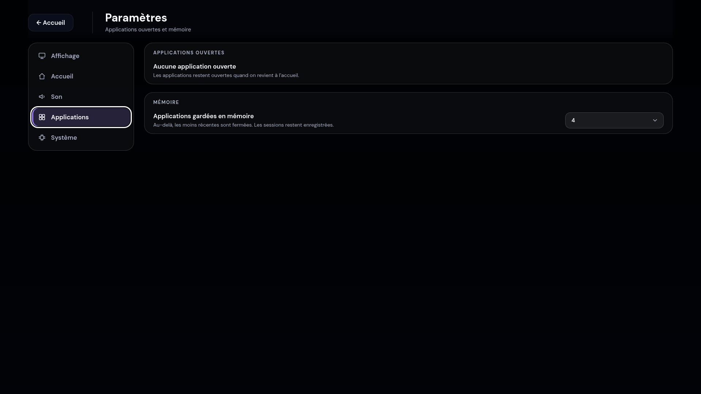 |
| **Système** | **Confirmation** |
| 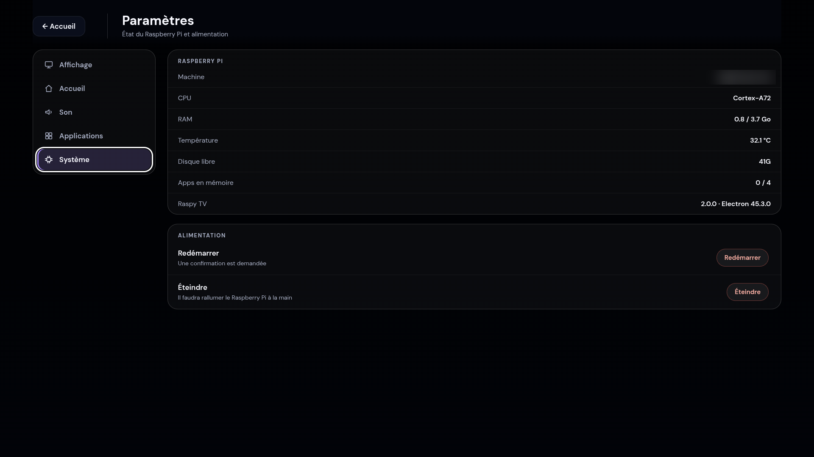 | 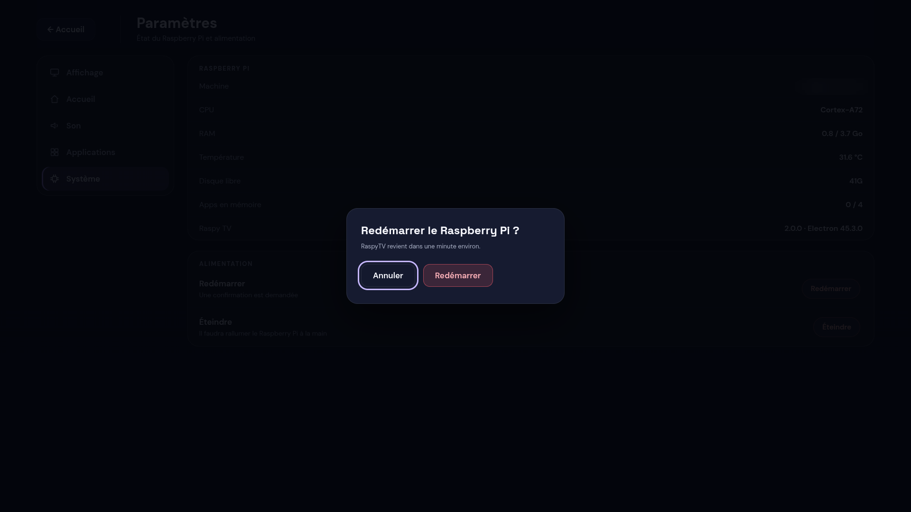 |

À la croix directionnelle, haut et bas restent dans la colonne (onglets ou réglages). La flèche droite entre dans le réglage en face, et la flèche gauche revient à l'onglet actif.

> Les captures viennent d'un vrai Raspberry Pi. Les éléments personnels (nom de machine, noms des casques, raccourci privé) sont floutés.

## Installation

Sur Raspberry Pi OS Bookworm (session labwc) :

```bash
sudo apt install nodejs npm
git clone https://github.com/0x80070006/RaspyTV.git ~/MediaHub
cd ~/MediaHub
./install.sh
```

`install.sh` effectue ces étapes :

- il installe les dépendances : GTK layer-shell, `pactl`, `bluetoothctl`, `playerctl`, `swaybg`, `kanshi`, `grim` et Electron ;
- il installe le service utilisateur `raspytv.service` ;
- il ajoute l'autostart ;
- il crée `~/.config/raspy-tv/site.json` à partir de `site.example.json`.

Pour une session dédiée à RaspyTV, copiez `labwc-autostart` vers `~/.config/labwc/autostart`. Pour les jeux, installez aussi `moonlight-qt`.

```bash
systemctl --user start raspytv       # démarrer
systemctl --user restart raspytv     # après une modification
tail -f ~/.config/raspy-tv/logs/raspy-tv.log
```

Le détail, avec la règle sudo pour l'alimentation et le dépannage, est dans le wiki : [Installation](https://github.com/0x80070006/RaspyTV/wiki/Installation).

## Configuration

Les adresses réseau et la localisation ne sont pas dans le code. Elles se règlent dans `~/.config/raspy-tv/site.json` :

| Clé | Rôle |
| --- | --- |
| `jellyfinUrl` | Serveur Jellyfin (accueil, « Continuer », lecture). |
| `moonlightHost` | Adresse du PC de jeu ; vide pour masquer les jeux. |
| `dashboardUrl`, `immichUrl` | Tuiles facultatives ; une URL vide masque la tuile. |
| `weatherLatitude`, `weatherLongitude`, `weatherLabel`, `timezone` | Météo Open-Meteo, nom de la ville affiché et fuseau horaire. |

Les réglages de l'interface, le cache, la session Jellyfin et les journaux sont rangés dans `~/.config/raspy-tv/`.

**Redémarrer / Éteindre** passent par `sudo -n systemctl reboot|poweroff` et demandent une règle sudo explicite, par exemple dans `/etc/sudoers.d/raspytv` :

```
<utilisateur> ALL=(root) NOPASSWD: /usr/bin/systemctl reboot, /usr/bin/systemctl poweroff
```

## Commandes

| Touche | Action |
| --- | --- |
| Flèches, `Entrée` | Navigation et validation |
| `Échap` | Retour, fermeture d'une fenêtre |
| `Home` ou `Ctrl+Alt+H` | Accueil |
| `Ctrl+Alt+Shift+Q` | Quitter RaspyTV |

La manette PS4 est gérée par le service [TelecomHand](https://github.com/0x80070006/TelecomHand) : PS, Share, Options, L1/R1 pour le volume, L2/R2 pour changer de titre. La correspondance complète est dans le wiki : [Manette](https://github.com/0x80070006/RaspyTV/wiki/Manette).

D'autres programmes peuvent piloter RaspyTV par le socket `$XDG_RUNTIME_DIR/raspytv-nav.sock` (JSON) : voir le wiki, [Socket de commande](https://github.com/0x80070006/RaspyTV/wiki/Socket-de-commande).

## Architecture

| Fichier | Rôle |
| --- | --- |
| `main.js` | Processus principal Electron : fenêtre kiosque, vues des applications, Jellyfin, NouTube, Moonlight, audio, météo, socket de commande. |
| `preload.js` | Pont `window.raspy` exposé à l'interface (isolation de contexte). |
| `index.html`, `renderer.js`, `style.css`, `layout-override.css` | Accueil et paramètres. |
| `tv-input-adapter.js` | Navigation à la croix directionnelle dans les sites web. |
| `layer-nav.py` | Barre latérale, indicateur de volume et panneau PS en GTK layer-shell (couche overlay Wayland). |
| `noutube-preload.js`, `noutube/` | Script NouTube (AGPL-3.0) injecté dans YouTube et YouTube Music. |
| `nav.*`, `edge.html`, `moonlight-overlay.*`, `overlay-preload.js` | Détection du bord d'écran et surcouche pendant Moonlight. |
| `gallery.*`, `keyboard.*` | Mode Tableau et clavier virtuel. |
| `raspytv.service`, `start-kiosk.sh`, `labwc-autostart` | Démarrage et relance automatique. |
| `demo.html`, `demo/mock-raspy.js` | Aperçu de l'accueil dans un navigateur, avec des données fictives. |

Les sites sont chargés dans des vues isolées (`sandbox`, `contextIsolation`, sans `nodeIntegration`), les pop-ups sont bloquées et chaque appel IPC vérifie la fenêtre qui l'envoie. Le détail est dans le wiki : [Architecture](https://github.com/0x80070006/RaspyTV/wiki/Architecture).

## Licences

- Le code de RaspyTV est sous licence **MIT** (voir [`LICENSE`](LICENSE)), sauf les éléments tiers ci-dessous.
- `noutube/noutube-content.js` vient de [NouTube](https://github.com/nonbili/NouTube) et reste sous licence **AGPL-3.0** (voir `noutube/LICENSE`).
- Les polices DM Sans et Space Grotesk sont sous licence SIL Open Font.
- Les logos des services appartiennent à leurs propriétaires et servent uniquement à identifier les tuiles. Les logos complets viennent de Wikimedia Commons et des dépôts officiels de Jellyfin (CC BY-SA 4.0) et d'Immich.
- Les affiches visibles sur les captures appartiennent à leurs ayants droit.
