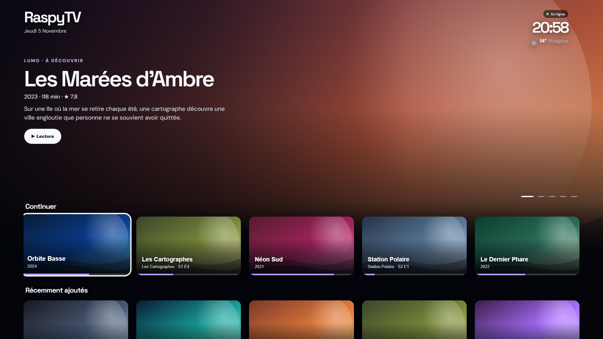
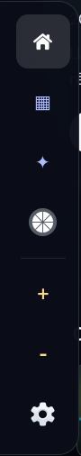
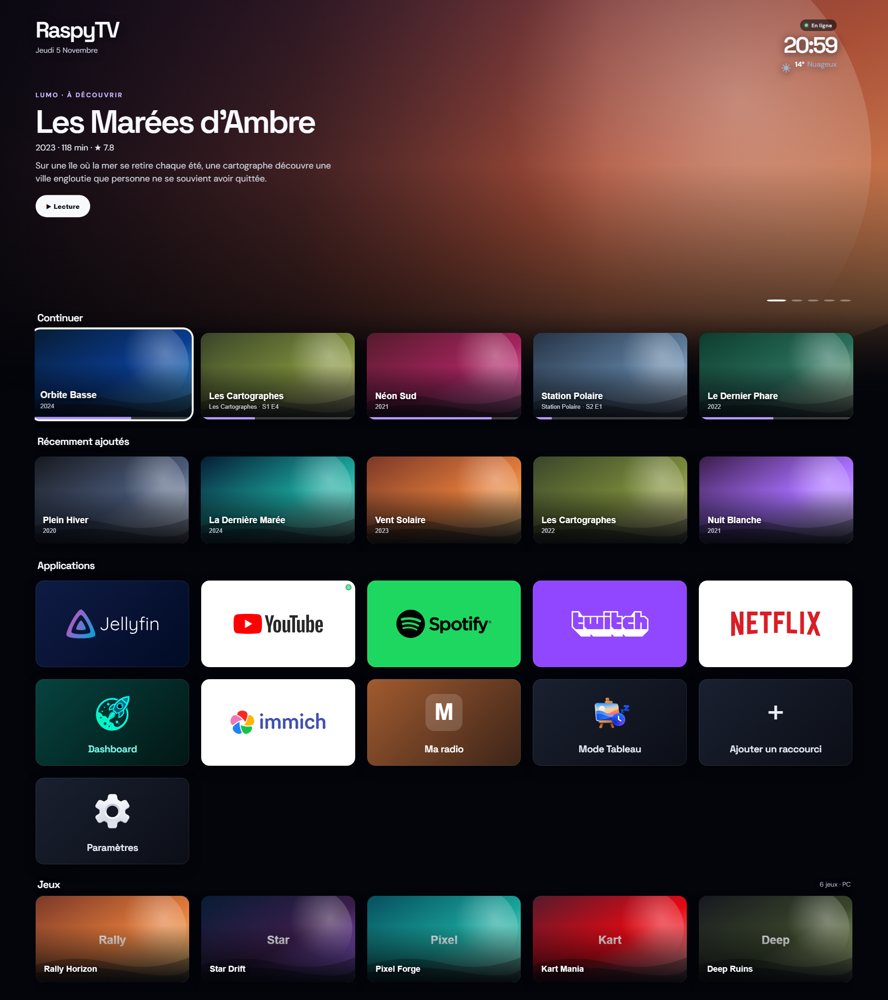
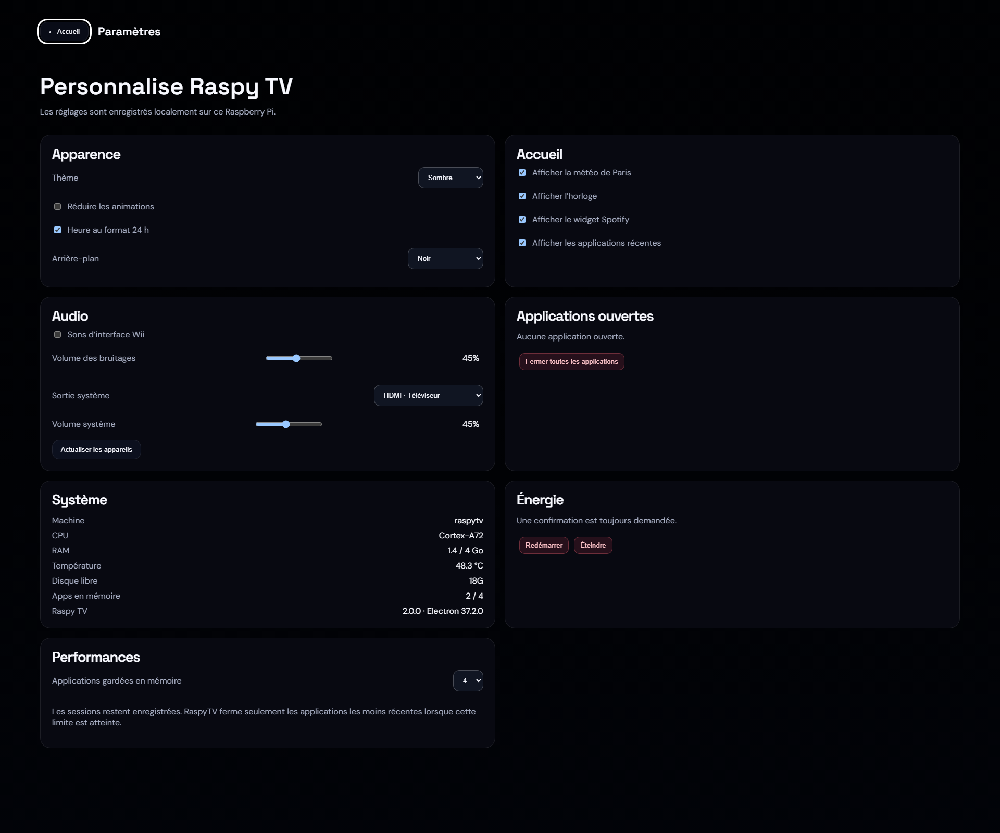

# RaspyTV

Interface Smart TV pour Raspberry Pi 4, construite avec Electron. Elle démarre en kiosque plein écran au lancement de la session graphique (labwc / Wayland) et sert de page d'accueil au salon : médiathèque Jellyfin, services de streaming, jeux Moonlight et réglages du système, le tout pilotable à la télécommande, au clavier ou à la manette.



> Les captures de l'interface utilisent des films, séries et jeux fictifs (`demo.html`), pas une vraie médiathèque.

## Fonctionnalités

- **Accueil cinéma** : bandeau des films de la médiathèque Jellyfin (7 titres tirés au sort chaque jour, défilement automatique), rangées « Continuer » (avec la progression de lecture) et « Récemment ajoutés », lecture directe depuis l'accueil.
- **Tuiles uniformes** : « Continuer », « Récemment ajoutés », applications et jeux partagent une même case 16:9, cinq par ligne. Chaque service affiche son logo complet sur la couleur de sa marque, et un point vert signale une application déjà ouverte.
- **Applications persistantes** : Jellyfin, YouTube, Spotify, Twitch, Netflix, un dashboard et Immich s'ouvrent chacun dans leur propre vue, avec leur session conservée. Les applications les moins récentes sont fermées au-delà d'une limite réglable (2 à 6) pour ménager la mémoire du Pi.
- **Raccourcis personnalisés** : ajout d'un site par son URL, icône récupérée automatiquement.
- **Jeux Moonlight** : liste des jeux publiés par le PC (Sunshine / GameStream) et lancement natif de `moonlight-qt`, avec clavier virtuel pendant le stream.
- **Barre latérale** : invisible au repos, elle se déplie quand le pointeur touche le bord gauche de l'écran et reste au-dessus de toutes les applications (accueil, applications, Moonlight, volume, paramètres).
- **Mode Tableau** : diaporama plein écran d'images, pour quand la TV ne sert pas.
- **Réglages** : thème, arrière-plan (couleur, image ou vidéo), météo, horloge, sortie et volume audio (PipeWire / PulseAudio), informations système, redémarrage et extinction.
- **Navigation TV** : flèches avec déplacement spatial entre les éléments, `Entrée` pour valider, `Échap` pour revenir, manette compatible (A / B / croix directionnelle).

<p align="center">
  
</p>





## Architecture

| Fichier | Rôle |
| --- | --- |
| `main.js` | Processus principal Electron : fenêtre kiosque, vues des applications, session Jellyfin, Moonlight, audio, météo, IPC. |
| `preload.js` | Pont `window.raspy` exposé à l'interface (isolation de contexte activée). |
| `index.html`, `renderer.js`, `style.css`, `layout-override.css` | Accueil et paramètres. |
| `gallery.js`, `gallery.css` | Mode Tableau. |
| `keyboard.html`, `keyboard.js`, `keyboard.css` | Clavier virtuel pour les champs de saisie des applications web. |
| `layer-nav.py` | Barre latérale en GTK layer-shell (couche overlay Wayland), reliée à Electron par un socket Unix. |
| `moonlight-kiosk-setup.py` | Prépare Moonlight (fenêtré sans bordure, souris non capturée) et ajoute une règle labwc, avec sauvegarde des fichiers d'origine. |
| `start-kiosk.sh` | Boucle de lancement : relance l'interface après un plantage, s'arrête sur une sortie normale. |
| `labwc-autostart` | Exemple d'autostart labwc qui lance directement RaspyTV. |
| `demo.html`, `demo/mock-raspy.js` | Aperçu de l'interface dans un navigateur, avec des données fictives. |

Les sites sont chargés dans des vues isolées (`sandbox`, `contextIsolation`, pas de `nodeIntegration`), les pop-ups sont bloquées et seule la permission plein écran est accordée. Chaque appel IPC vérifie la fenêtre qui l'envoie.

## Installation

Prérequis sur Raspberry Pi OS (Bookworm, session labwc) :

```bash
sudo apt install nodejs npm python3-gi gir1.2-gtk-3.0 gir1.2-gtklayershell-0.1 squeekboard swaybg kanshi
# optionnel : moonlight-qt pour les jeux, grim pour les captures
```

Puis :

```bash
git clone https://github.com/0x80070006/RaspyTV.git ~/MediaHub
cd ~/MediaHub
./install.sh
```

`install.sh` installe les dépendances, ajoute l'entrée d'autostart et crée `~/.config/raspy-tv/site.json` à partir de `site.example.json`. Pour une session dédiée uniquement à RaspyTV, copier `labwc-autostart` vers `~/.config/labwc/autostart`.

Lancement manuel : `npm start`.

## Configuration

Les adresses réseau et la localisation ne sont pas dans le code. Elles se règlent dans `~/.config/raspy-tv/site.json` :

| Clé | Rôle |
| --- | --- |
| `jellyfinUrl` | Serveur Jellyfin sur le réseau local (accueil, « Continuer », lecture). |
| `moonlightHost` | Adresse du PC de jeu ; vide pour désactiver les jeux. |
| `dashboardUrl`, `immichUrl` | Tuiles facultatives ; une URL vide masque la tuile. |
| `weatherLatitude`, `weatherLongitude`, `weatherLabel`, `timezone` | Météo Open-Meteo et fuseau horaire. |

Les réglages de l'interface, le cache d'icônes, la session Jellyfin et les journaux sont rangés dans `~/.config/raspy-tv/` (droits `0700` / `0600`). La session Jellyfin est chiffrée avec `safeStorage` quand un trousseau est disponible.

**Arrière-plans et Mode Tableau** : aucun média n'est fourni. Déposer des vidéos MP4 silencieuses (720p / 24 i/s recommandé sur Pi 4) dans `assets/backgrounds/` et les déclarer dans `backgrounds` en haut de `renderer.js` ; déposer des images dans `assets/art/` et les lister dans `gallery.js`.

**Redémarrer / Éteindre** utilisent `sudo -n systemctl reboot|poweroff` et demandent une règle sudo explicite, par exemple dans `/etc/sudoers.d/raspytv` :

```
<utilisateur> ALL=(root) NOPASSWD: /usr/bin/systemctl reboot, /usr/bin/systemctl poweroff
```

## Raccourcis

| Touche | Action |
| --- | --- |
| `Home` ou `Ctrl+Alt+H` | Retour à l'accueil |
| `Échap` | Retour depuis une application ou fermeture d'une fenêtre |
| Flèches, `Entrée` | Navigation et validation |
| `Ctrl+Alt+Shift+Q` | Quitter RaspyTV |

## Aperçu sans Raspberry Pi

Ouvrir `demo.html` dans Chrome ou Edge : l'interface se charge avec `demo/mock-raspy.js`, qui remplace le pont Electron par des données fictives. Ajouter `?page=settings` à l'URL pour afficher les paramètres.

## Licences des ressources

Les polices DM Sans et Space Grotesk sont distribuées sous licence SIL Open Font. Les logos des services (YouTube, Spotify, Twitch, Netflix, Jellyfin, Immich, Dashy) appartiennent à leurs propriétaires respectifs et ne servent qu'à identifier les tuiles. Les logos complets de `assets/logos/` proviennent de Wikimedia Commons (YouTube, Netflix, Spotify, Twitch) et des dépôts officiels des projets : Jellyfin (`jellyfin/jellyfin-ux`, CC BY-SA 4.0) et Immich (`immich-app/immich`). Les logos Spotify et Twitch ont été recolorés pour leur fond de marque.
